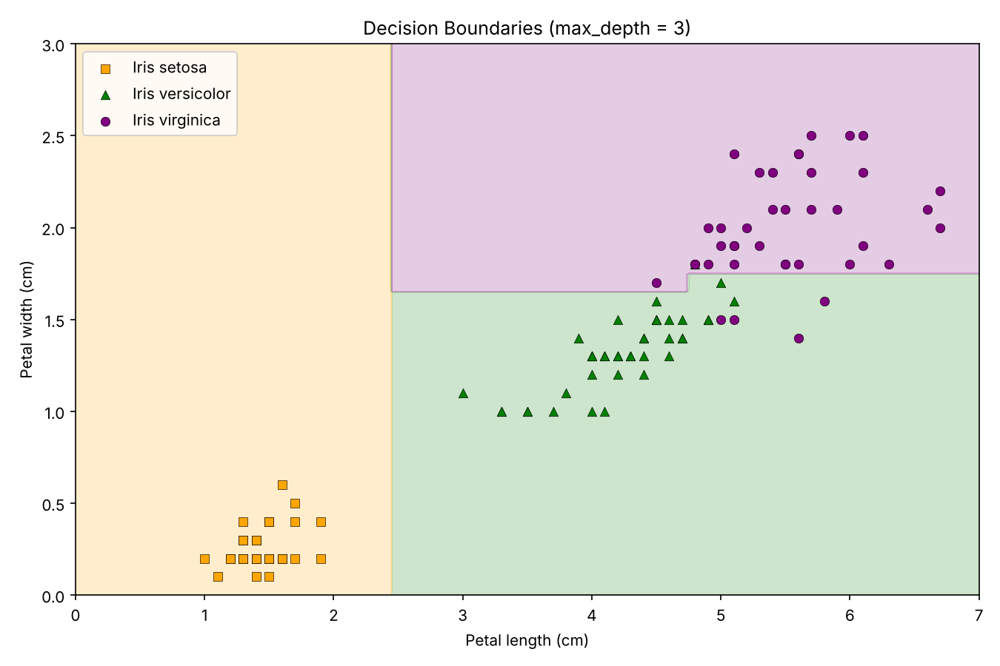
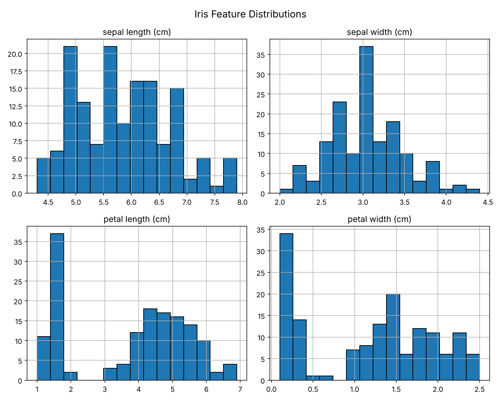
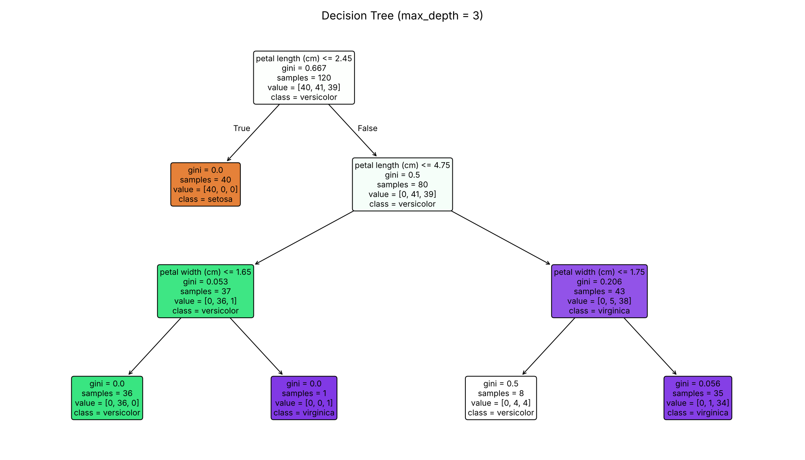
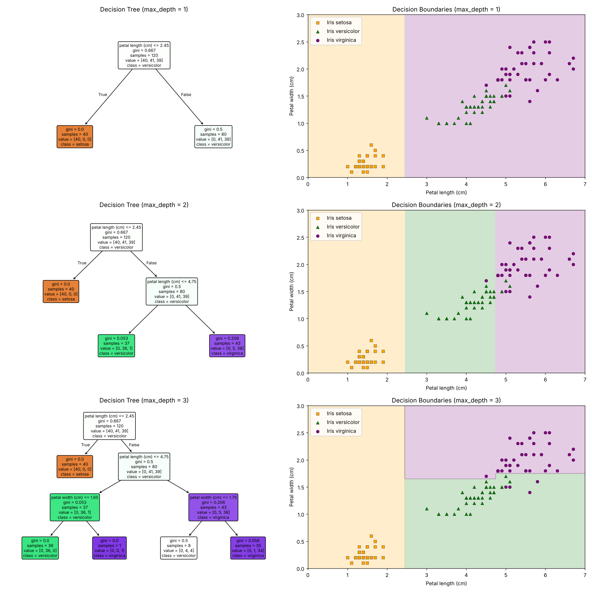

# Iris Flower Classification with Decision Trees 🪻

This repository contains a supervised machine learning project that classifies three iris species using a decision tree classifier. The analysis shows how a shallow, interpretable tree can achieve high accuracy using only two well-chosen features, and how model depth shapes decision boundaries.

---

## Project Overview 📊

This project uses scikit-learn's `DecisionTreeClassifier` to classify iris flowers into three species (*Setosa*, *Versicolor*, *Virginica*) from physical measurements. Using R.A. Fisher's classic Iris dataset of 150 samples (50 per class), the analysis moves from exploratory data analysis through feature selection, model training, evaluation, and visual interpretation of how the tree partitions the feature space.

**Dataset at a glance:**
- 150 samples, 4 numeric features (sepal length, sepal width, petal length, petal width in cm)
- 3 balanced classes (33.3% each)
- No missing values; all features are continuous (`float64`)

---

## Key Findings 🔎

### Petal Measurements Drive Classification

Exploratory analysis showed that petal features separate the species far more clearly than sepal features:

| Feature | Class Correlation |
|--------------|-------------------|
| Petal width | 0.9565 |
| Petal length | 0.9490 |
| Sepal length | 0.7826 |
| Sepal width | -0.4194 |

The histograms confirm this: petal length and petal width are **bimodal with a clear gap**, isolating one species entirely, while sepal measurements overlap heavily across classes.

### Decision Rules Learned by the Tree

Training on petal length and petal width alone, the tree learned a short, human-readable set of rules:

- **Petal length ≤ 2.45 cm** - *Iris setosa* (all 40 training samples, a perfectly pure split)
- **Petal length 2.45-4.75 cm** - *Iris versicolor* (36 of 37 samples)
- **Petal length > 4.75 cm and petal width > 1.75 cm** - *Iris virginica* (34 of 35 samples)
- **Petal length > 4.75 cm and petal width ≤ 1.75 cm** - an evenly mixed zone (4 versicolor, 4 virginica) where nearly all remaining errors occur

### Linear Separability

*Setosa* is linearly separable from the other two species and is classified with no errors. *Versicolor* and *Virginica* overlap slightly, which accounts for nearly all misclassifications.

---

## Models and Performance 📈

### Model Configuration

- **Algorithm**: `DecisionTreeClassifier`
- **Features**: petal length, petal width
- **Max depth**: 3
- **Train/test split**: 80/20 (`random_state=42`), yielding 120 training and 30 test samples

### Accuracy Results

| Dataset | Accuracy |
|--------------|----------|
| Training set | 95.83% |
| Test set | 100.00% |

Test accuracy slightly exceeds training accuracy, indicating the model is **not overfitting**. Because the test set contains only 30 samples, a single misclassification would shift accuracy by about 3.3 percentage points, so cross-validation would give a more stable performance estimate (see Future Work).

---

## Key Takeaways 💡

1. **Feature Selection Matters More Than Complexity**
   - Two well-chosen features achieved high accuracy without the sepal measurements
   - Simple EDA (histograms and class correlations) identified the most predictive features before any modeling

2. **Interpretability Is a Strength**
   - The full model can be expressed as a handful of if/then rules a non-technical stakeholder can follow
   - Visualized decision boundaries make model behavior transparent and auditable

3. **Controlling Depth Prevents Overfitting**
   - Limiting `max_depth` to 3 kept the model generalizable while still capturing class structure
   - Accuracy gains diminish quickly after depth 2, while deeper trees increase the risk of fitting noise

---

## Repository Contents 📁

1. **Notebooks**
   - [Iris Decision Tree Classification](iris-decision-tree-classification.ipynb) (IPYNB)

2. **Visualizations**
   - [Feature Histograms](feature-histograms.png) (PNG)
   - [Decision Tree, Depth 3](decision-tree-depth-3.png) (PNG)
   - [Decision Boundaries, Depth 3](decision-boundaries-depth-3.png) (PNG)
   - [Depth Comparison, Depths 1-3](depth-comparison.png) (PNG)

---

## Model Evolution 🧠

Visualizing trees at increasing depths shows how each additional split refines the decision boundaries:

| Max Depth | Training Accuracy | Test Accuracy |
|-----------|-------------------|---------------|
| 1 | 67.50% | 63.33% |
| 2 | 95.00% | 96.67% |
| 3 | 95.83% | 100.00% |

1. **Depth 1**: A single split on petal length isolates *Setosa* perfectly, but groups versicolor and virginica together.

2. **Depth 2**: A second petal-length split at 4.75 cm separates *Versicolor* from *Virginica*, producing the largest accuracy jump.

3. **Depth 3**: Petal-width splits refine the overlap region between the two similar species, adding a smaller incremental gain.

This progression illustrates the core tradeoff in tree-based models: the biggest gains come early, and each additional level adds less while increasing the risk of fitting noise.

---

## Future Work 🚀

Potential extensions of this analysis include:

- k-fold cross-validation for a more reliable accuracy estimate on a small dataset
- Confusion matrix and per-class precision/recall analysis
- Hyperparameter tuning (`max_depth`, `min_samples_leaf`) with `GridSearchCV`
- Comparison against logistic regression, k-nearest neighbors, and random forest
- Retraining with all four features to quantify the contribution of sepal measurements

---

## Contact Information ✉️

For inquiries about this analysis:

- [LinkedIn Profile](https://www.linkedin.com/in/melissaslawsky/)
- [Client Results](https://melissaslawsky.com/portfolio/)
- [Tableau Portfolio](https://public.tableau.com/app/profile/melissa.slawsky1925/vizzes)
- [Email](mailto:melissa@melissaslawsky.com)

---

## Disclaimer 📝

This project was completed as part of the [Udacity Data Science Nanodegree](https://www.udacity.com/course/data-scientist-nanodegree--nd025) program. The Iris dataset is publicly available through scikit-learn, and the exercise structure was provided by Udacity. All analysis, interpretation, and documentation are my own.

---

© Melissa Slawsky 2026. All Rights Reserved.
